# GitHub 产品展示

这页集中放置真实图片作品、真实 Electron 界面截图和使用示例。九张作品来自 2026-10-18 的 SparkAI WorkSpace AI Native 展示项目；每次真实请求只生成 1 张，结果保存后再继续下一张。本轮复用已验证成果，没有新增模型请求，没有使用颜色方块、Mock、fixture、placeholder 或测试报告截图。

公开下载是 [v1.0.9 Release](https://github.com/naMeaning/SparkAI-WorkSpace/releases/tag/v1.0.9)。以下界面全部来自 `main` 对应的已安装本地开发构建，应用版本仍为 `1.0.9`；同一版本号不表示与公开安装包具有相同能力。项目知识、成果检索及后续模板改进尚未进入该公开 Release。

## 真实界面


真实九图项目中的独立成果与 Agent 历史时间线同时可见；第 02、03 张音箱之间保留实际来源连线。画布右侧边缘另有历史宣传图容器，文字为当时的本地排版；本页作品区全部采用无本地文字覆盖的干净原图。

截图通过仓库自带 AI Native CLI 选择成果、定位画布和建立隔离公开示例，再从真实 Electron 页面使用 CDP `Page.captureScreenshot` 取得。只转换为 WebP，未拼接界面、替换文字或覆盖图片。七张截图均已逐张人工检查，未显示 API Key、Cookie、Token、License、签名 URL、用户路径、私人项目或完整请求体；尺寸、来源和 SHA-256 见[截图清单](#截图清单)。

## 用真实作品演示

### 选中商品母图，继续编辑

在画布中选中第 02 张音箱，说明哪些细节必须保留。下面是实际编辑要求的简写：

```text
保留焦橙音箱外形、织物网罩、顶部黄铜旋钮和皮革提带，保持原来的产品视角。
把台座与背景改为清晨海岸的玄武岩、海浪和日出，保留自然接触阴影。
输出 1 张 1:1 图片，无文字、品牌或水印。
```

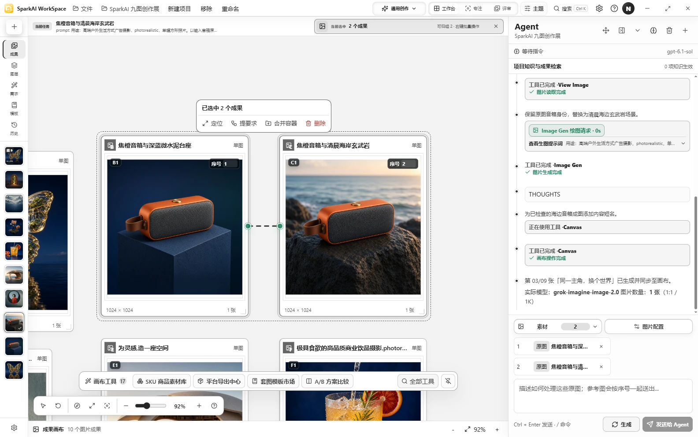

这张截图打开第 03 张的真实编辑会话，左侧为第 02 张母图、右侧为海岸结果，时间线记录 `Image Gen` 与结果保存。它们是已完成的历史真实请求，本轮截图没有重新提交。

<details>
<summary>查看母图被选中和 Agent 时间线的完整界面</summary>

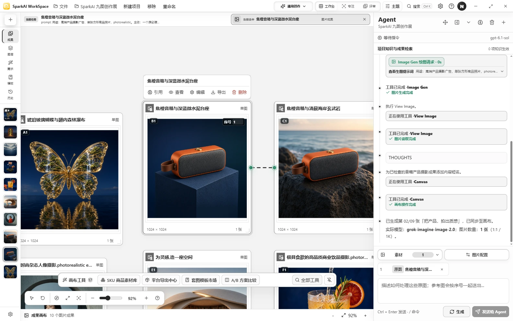

第 02 张母图被选中，成为 Agent 当前图片上下文；时间线是对应的真实商品生成会话。

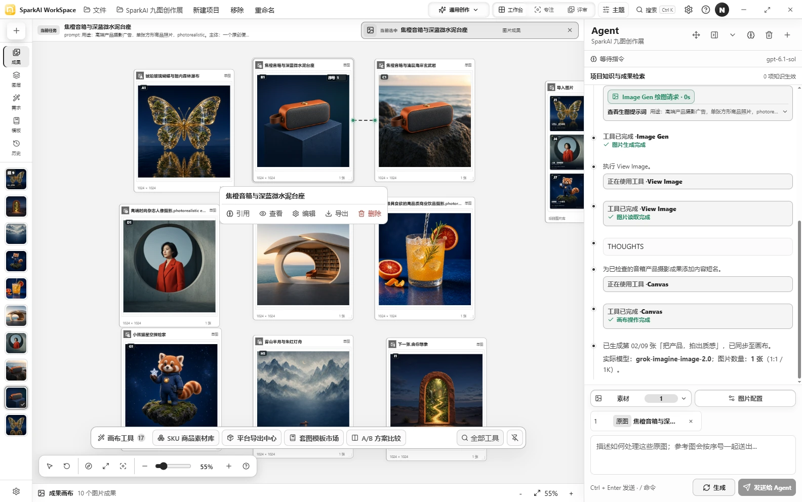

九张成果保留在同一画布，Agent 显示第 02 张生成、读图和保存的历史过程。完成状态表示历史工具执行与落盘，不代替使用者对作品的检查。

</details>

### 把要求保存下来

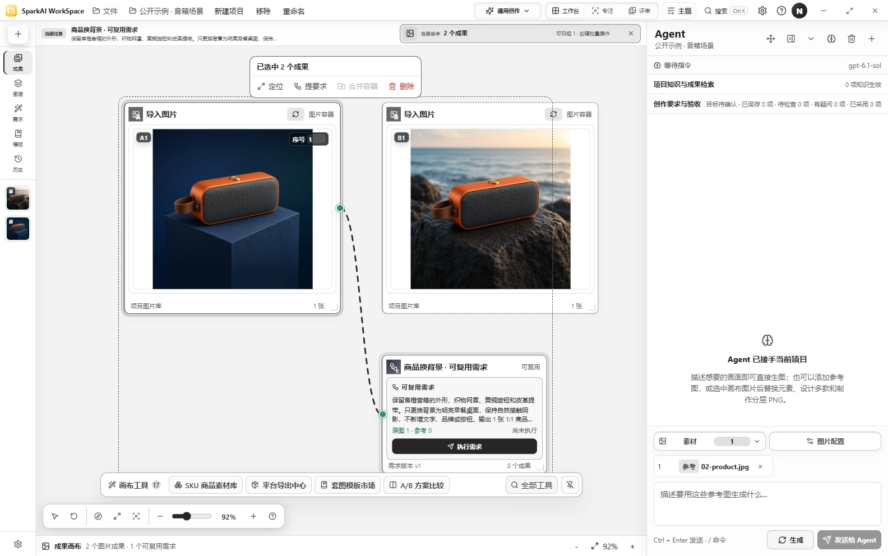

隔离项目“公开示例 · 音箱场景”导入第 02、03 张真实原图，再通过原生 CLI 建立“商品换背景 · 可复用需求”，母图以 SOURCE 连接到需求。需求写明外形保持、早餐桌面场景和单张输出，界面显示“尚未执行”；旁边的海岸图是已有作品 03。详细操作见[编辑与复用教程](./tutorials/02-edit-and-reuse-results.md)。

### 并排比较已有成果

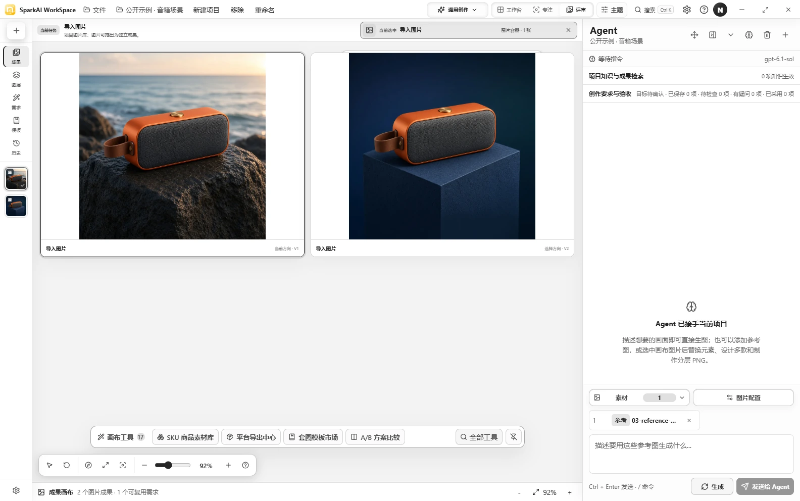

同一隔离项目使用真实的“评审”界面并排查看海岸结果与棚拍母图。两张图复用历史成果，未为了截图再次生成。

### 从项目中找回成果（开发版）

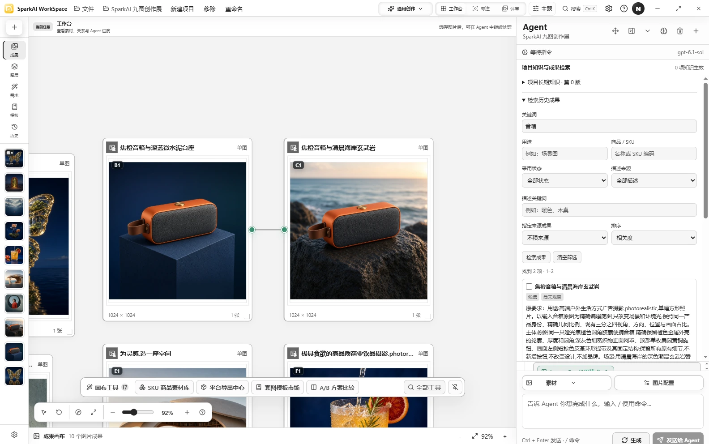

在真实九图项目的“项目知识与成果检索”中输入“音箱”，找到母图和海岸结果两项。匹配依据是已有名称与创作要求；界面保留“尚未观察”的状态，不把文本检索当成新的视觉识别证明。检索不调用图片模型。

## 真实图片作品

以下 9 个文件逐字节复制自 `artifacts/showcase-2026-10-18/originals/` 中的同名文件，与原 `manifest.json` 的 SHA-256 一致。实际模型均为 `grok-imagine-image-2.0`，原始文件为 JPEG 1024 × 1024；标题、说明与提示词放在 Markdown 中，未复制旧宣传排版 WebP。实际生成与来源证据见[九图展示记录](./AI_NATIVE_SHOWCASE_2026-10-18.md)。

### 01 · 让想法，成为画面

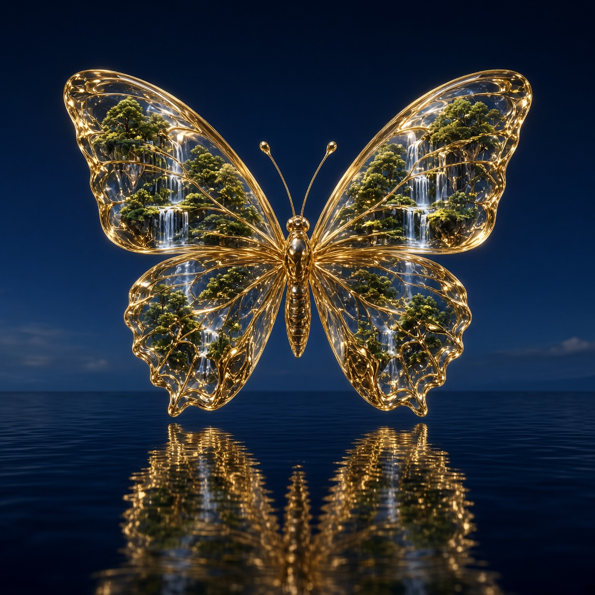

独立生成的创意视觉：透明琥珀翅面、微型森林和水面倒影。

- 模型：`grok-imagine-image-2.0`
- 原始尺寸/格式：1024 × 1024，JPEG
- SHA-256：`6963ff501c791fed1360107ef627de8c476f59d621ba4b10ab4aaab6bc08c692`

### 02 · 把产品，拍出质感


独立生成的商品母图，用于后续编辑和换场景。

- 模型：`grok-imagine-image-2.0`
- 原始尺寸/格式：1024 × 1024，JPEG
- SHA-256：`6add9fb90a68c6c27b22b8996194216cdfe62e885cd200db6c159ec8a5d83956`

### 03 · 同一主角，换个世界


以第 02 张音箱作为 SOURCE 编辑，要求保持产品设计并换成清晨海岸背景；项目中保留 `B → C` 的来源关系。

- 模型：`grok-imagine-image-2.0`
- 原始尺寸/格式：1024 × 1024，JPEG
- SHA-256：`a584c7ee0a229ddbd5de0a7a5fae9613ea6e47a01a9fcdcf3dab73f0e2bb4708`

### 04 · 人像，自有情绪

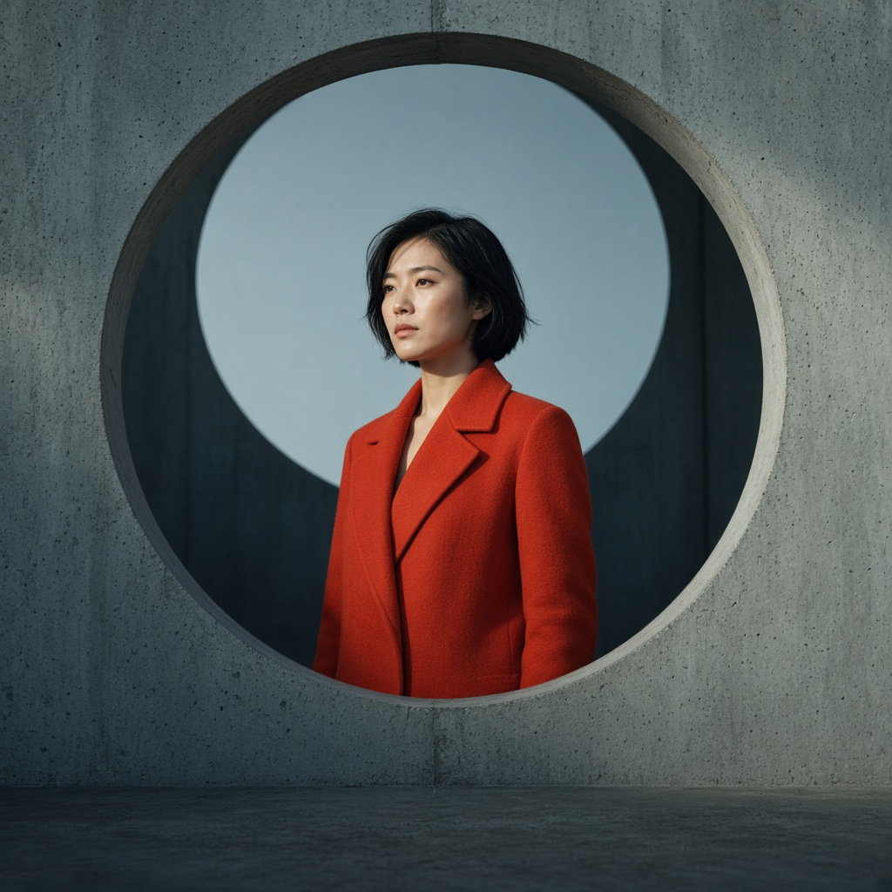

独立生成的人像摄影示例。

- 模型：`grok-imagine-image-2.0`
- 原始尺寸/格式：1024 × 1024，JPEG
- SHA-256：`1ab7f5c9e203ff16a8b28b2203264737bed148758e72a9ad4c4b85c4042d1d35`

### 05 · 为灵感，造一座空间

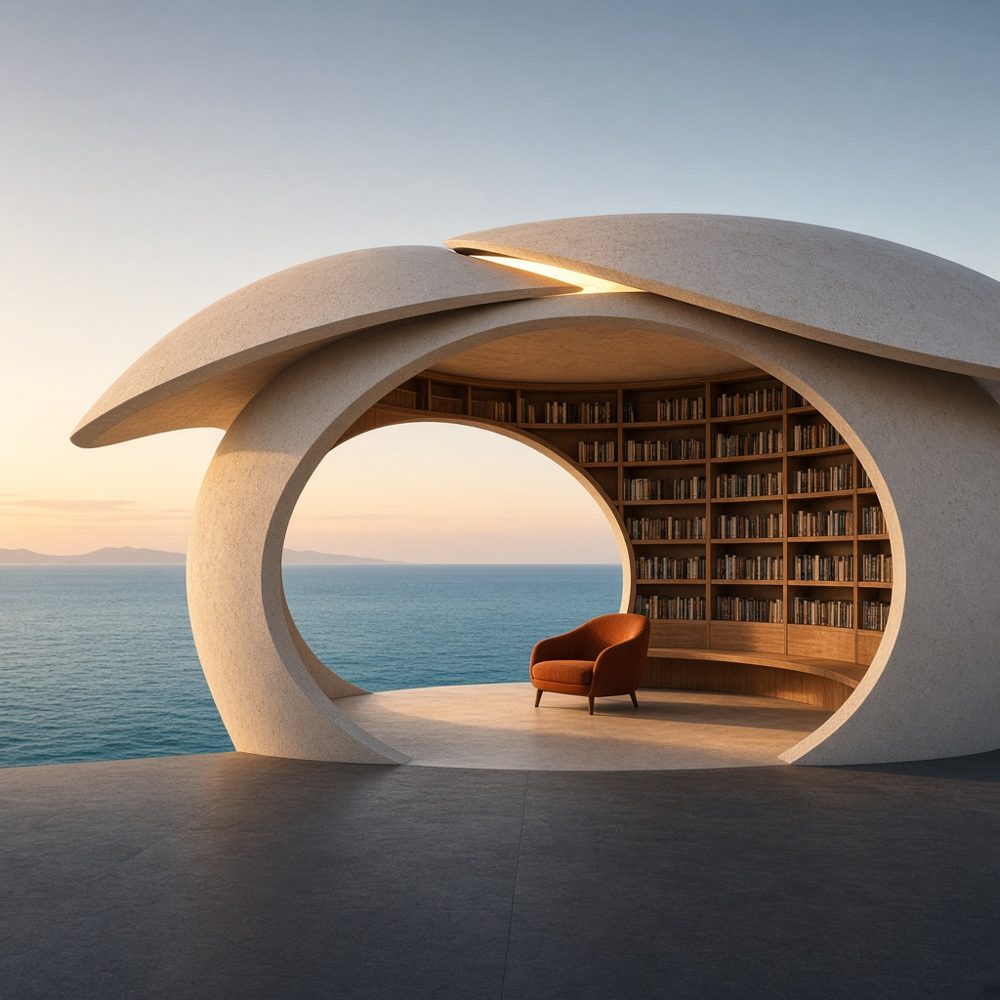

独立生成的空间与建筑摄影示例。

- 模型：`grok-imagine-image-2.0`
- 原始尺寸/格式：1024 × 1024，JPEG
- SHA-256：`77dc86f7156e75b0e142a87348830ffeba983abf512d58cd95e4c623d55b8608`

### 06 · 让日常，有点诱人

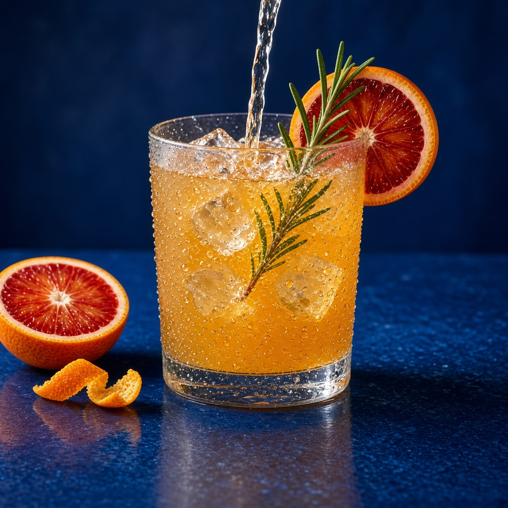

独立生成的饮品商业摄影示例。

- 模型：`grok-imagine-image-2.0`
- 原始尺寸/格式：1024 × 1024，JPEG
- SHA-256：`6a85b0d2a8409a105f242345ebac0e2f5039d59537d40a03d63c947bf9cd5621`

### 07 · 给想象，一个角色


独立生成的角色设计示例。

- 模型：`grok-imagine-image-2.0`
- 原始尺寸/格式：1024 × 1024，JPEG
- SHA-256：`21aac1fb01bc843dcf5cc00d68afeb72c8f6184e628a777e4cb55628bc82aea2`

### 08 · 东方意境，焕新


独立生成的东方山水意境示例。

- 模型：`grok-imagine-image-2.0`
- 原始尺寸/格式：1024 × 1024，JPEG
- SHA-256：`a34b5afd465f94e0dd234dd7b0c73d851d0b89f7b69cfd910b0a1ffa92cfcc95`

### 09 · 下一张，由你想象

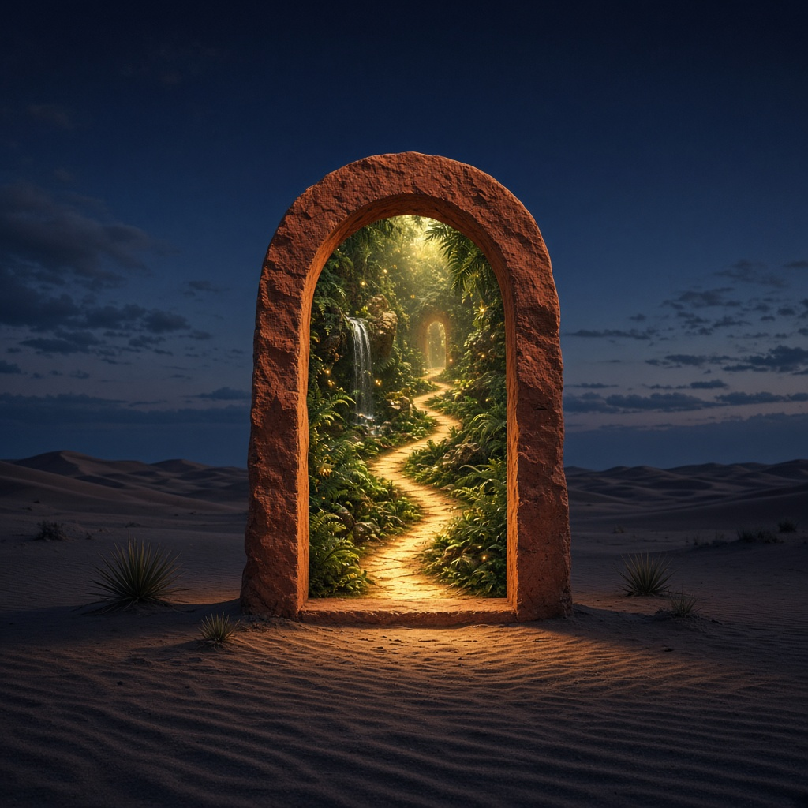

独立生成的超现实场景示例。

- 模型：`grok-imagine-image-2.0`
- 原始尺寸/格式：1024 × 1024，JPEG
- SHA-256：`15624fa88684a34bb5765cf82be90966df5c349f31f2937406c5a0a8088d811e`

## 最短复现路径

1. 阅读[教程 01：第一次让 Agent 完成一张图](./tutorials/01-first-agent-image.md)，了解导入、原图/参考图和结果保存。
2. 阅读[教程 02：编辑、批量、多款与可复用需求](./tutorials/02-edit-and-reuse-results.md)，了解选中成果后的继续编辑和来源关系。
3. 需要脚本时使用[CLI/MCP 教程](./tutorials/03-automation-cli.md)。
4. 九图项目的实际生成、模型、尺寸、保存状态和 `B → C` 来源证据见[真实 AI Native 九图展示记录](./AI_NATIVE_SHOWCASE_2026-10-18.md)。

## 截图清单

以下文件均为 2026-10-21 从真实 Electron 开发构建取得的 **1584 × 992 WebP**。截图本身无生成模型；画布中的作品均来自上述 `grok-imagine-image-2.0` 成果。前四项及检索截图来源为真实九图项目；需求与比较截图来源为仅导入真实作品 02、03 的隔离公开示例。

| 文件 | 来源视角 | SHA-256 |
| --- | --- | --- |
| `hero-canvas.webp` | 九图项目与真实 Agent 历史 | `76e96646a49f6213b8f3bda559cfadaf2bf7a4ba501726631f72f89656eed47f` |
| `real-product-base.webp` | 第 02 张母图选中与对应会话 | `671ac24e6063fc04f8f6c399787cb18c7a6dad279602df5e90c5523315d2bcd5` |
| `real-product-edit.webp` | 第 03 张编辑结果与 B → C 来源 | `f911f0385bc205ed3ee13e16b23efe160a211307d5d1712142b8b69175603bf7` |
| `real-agent-canvas.webp` | 九图画布与第 02 张真实工具时间线 | `c4fafd4c42d90d1882c74f041f5882520797845d86e2e3228648cec7bd2c8d26` |
| `real-requirement-template.webp` | 真实母图连接尚未执行的需求 | `014a749276c6f7bd2eec9f66878cd6c372dd2566c54b6b9ac2aa62a88991fb39` |
| `real-result-comparison.webp` | 两张真实音箱成果的评审界面 | `43a95f63c969726d05997d8333ea3320f5922227d2e58e54159b8b4392097279` |
| `real-knowledge-search.webp` | “音箱”关键词与两项历史成果 | `17aa8efd87dd88d7ed3031bc5c4e2911fa3cb77e3abcc1dde1bdc678d75f8b0e` |

## 公开边界

软件本身免费；模型费用由上游服务商决定。这里记录的是一次已完成的真实图片展示，不代表所有模型、所有 New API/Sub2API 站点或视频/Seedance 能力都已验证。公开下载以 [GitHub v1.0.9 Release](https://github.com/naMeaning/SparkAI-WorkSpace/releases/tag/v1.0.9) 为准，`main` 分支开发版能力不自动进入该 Release。

发布前请执行[隐私与发布前检查](./PRIVACY_AND_PUBLISHING.md)。本页不包含 API Key、Cookie、Token、License、签名 URL、客户资料或本机绝对路径。
